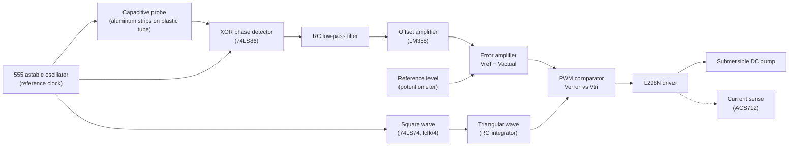

# Capacitive Water Level Controller

An analog closed-loop water level control system designed and implemented
for the EE 316 Electronic Design Project (project P1) at İzmir Institute of Technology, June 2026.

The system detects liquid-level variations using a custom cylindrical
capacitive sensor. The sensor output is processed through phase detection,
filtering, amplification, error generation, and PWM stages. The resulting
PWM signal controls a submersible DC water pump through an L298N motor driver.
When the water level is low the pump runs at full duty cycle; as the level rises
the duty cycle drops and the pump switches off.

## How it works

| Stage | What it does | Main parts |
|---|---|---|
| Probe | Capacitance changes linearly with water height (design range: 5–15 cm of water, 213–661 pF) | Aluminum strips, plastic tube, 3D-printed frame |
| Oscillator | Generates the reference clock | 555 timer, astable mode |
| Phase detector | Compares the clock with the phase-shifted clock from the probe; pulse width tracks the level | 74LS86 (XOR) |
| Filter and offset | Turns the pulses into a DC level and shifts it into the control range | RC filter, LM358 |
| Error amplifier | Compares the measured level with the user-set reference | LM358, potentiometer |
| Triangular carrier | Divides the clock by 4 and integrates it into a triangle wave | 74LS74, RC network |
| PWM generator | Duty cycle follows the error: low water gives a fast pump | Comparator |
| Motor stage | Drives the pump with overcurrent protection | L298N, ACS712 |

## Key Features

- Custom cylindrical capacitive water-level sensor
- 555-based oscillator
- XOR-based phase detection
- RC filtering and LM358 signal amplification
- Adjustable reference water level
- PWM-based pump speed control
- Motor overcurrent protection
- LTspice simulation and real-world circuit testing

## Repository layout

| Path | Contents |
|---|---|
| `Water level project.kicad_*` | KiCad schematic, PCB and project files |
| `ltspice/` | LTspice schematic ([`EE316_30.06.2026.asc`](ltspice/EE316_30.06.2026.asc)) and a zip with the ACS712 model and simulation outputs |
| `datasheets/` | Datasheets: ACS712, BC847C, HD74LS74A, HD74LS86, L298, LM358, NE555 |
| `reports_and_demonstration/` | Final report (26 pages) and demonstration slides |
| `report.txt` | Log produced when the PCB was updated from the schematic in KiCad |

## Documents

- [Final report](reports_and_demonstration/Water_Level_Controller_final_report.pdf): design, revision history, challenges
- [Demonstration slides](reports_and_demonstration/Water_Level_Controller.pdf): block-by-block summary of the design

## Team

- Hasan Veysel Tutar: capacitor design and manufacturing, real circuit assembly, testing and troubleshooting
- Halil Yılmaz: simulations and circuit building assistance
- Doruk Öğüt: simulations and circuit building assistance
